# Irodori-TTS 性能比較結果

同一の公式モデルrevision・20入力・TYC054.wav（10.990秒、48kHz、24bit）を使用。RFは40、MFは4ステップ。読み上げ品質は評価していない。

検証した入力条件: **3120/3120**（測定成功 2992、拒否・失敗 128）。通常速度と詳細計測は各5回。表の時間はms、VRAMはMiB。全条件の測定・拒否理由の記録が完了。

ロード・初回推論は代表文章p09で3回。warmなどは文章ごとの中央値をさらに20文章で中央値に集計する。ピークVRAMは通常計測の最大観測値。

DiT B1/B4は実際のbatch別のforward時間。CFGを別々のB1 forwardで実行する実装があるため、呼び出し数も併記する。個別encoderに † のある実装は独立probeの値で、共有処理時間とは加算できない。

詳細条件と測定範囲は [README](../README.ja.md)、全入力の集計は [CSV](per-input.csv)。

## RF / fp32 / reencode

| 実装 | backend | モデル / codec | 完了入力 | load | 初回 | warm | sample | loop | DiT B1 / B4 | calls | DACVAE | RTF | 常駐 | peak |
|---|---|---|---:|---:|---:|---:|---:|---:|---:|---:|---:|---:|---:|---:|
| Irodori-TTS-Optimiz | cuda | fp32 / fp32 | 20/20 | 4222.4 | 15213.5 | 1396.5 | 1224.0 | 1217.5 | 15.65 / 45.47 | 40 | 110.0 | 0.058 | 6479 | 7036 |
| Irodori-TTS-burn | vulkan | fp32 / fp32 | 20/20 | 4469.4 | 29777.5 | 2263.9 | 1900.4 | 1888.8 | 22.43 / 70.73 | 40 | 120.2 | 0.098 | 7507 | 7960 |
| Irodori-TTS | cuda | fp32 / fp32 | 20/20 | 4117.5 | 1387.4 | 1371.3 | 1173.3 | 1167.4 | 15.06 / 43.56 | 40 | 119.8 | 0.057 | 10122 | 12368 |
| audio.cpp | cuda | fp32 / fp32 | 20/20 | 1184.5 | 1430.9 | 1436.8 | 1162.2 | 1154.6 | 12.57 / 43.33 | 40 | 195.8 | 0.062 | 3972 | 9516 |
| audio.cpp | vulkan | fp32 / fp32 | 20/20 | 1163.5 | 1123.8 | 1101.2 | 702.4 | 688.9 | 9.43 / 20.93 | 40 | 234.7 | 0.046 | 5287 | 11883 |
| speech.cpp | cuda | fp32 / fp32 | 20/20 | 326.0 | 1822.2 | 1861.3 | 1543.3 | 1543.3 | 16.42 / 61.00 | 40 | 255.0 | 0.079 | 4384 | 4474 |
| speech.cpp | vulkan | fp32 / fp32 | 20/20 | 464.7 | 992.9 | 996.6 | 795.7 | 795.7 | 11.03 / 28.72 | 40 | 145.9 | 0.045 | 4045 | 4169 |
| sttts-gui | vulkan | fp32 / fp32 | 20/20 | 1334.3 | 8717.0 | 8347.5 | 7467.7 | 7427.5 | 73.88 / — | 100 | 753.6 | 0.351 | 4462 | 5299 |

| 実装 / backend | text tokenize | caption tokenize | text encode | caption encode | 共有encoder | 参照音声 合計 | 前処理 | encoder load | DACVAE encode | speaker encode |
|---|---:|---:|---:|---:|---:|---:|---:|---:|---:|---:|
| Irodori-TTS-Optimiz / cuda † | 0.5 | 0.2 | 8.1 | 11.4 | 16.3 | 48.9 | 21.6 | 0.0 | 23.3 | 2.0 |
| Irodori-TTS-burn / vulkan | 0.0 | 0.0 | 22.2 | 9.0 | 0.0 | 267.8 | 9.4 | 154.7 | 84.7 | 7.3 |
| Irodori-TTS / cuda | 0.5 | 0.2 | 8.1 | 11.4 | 0.0 | 48.8 | 21.2 | 0.0 | 24.7 | 2.4 |
| audio.cpp / cuda † | 1.9 | 0.1 | 6.8 | 11.8 | 18.9 | 51.5 | 2.8 | 0.0 | 47.6 | 1.7 |
| audio.cpp / vulkan † | 1.8 | 0.1 | 4.7 | 6.0 | 11.0 | 72.0 | 2.9 | 0.0 | 66.4 | 3.5 |
| speech.cpp / cuda † | 0.4 | 0.1 | 3.1 | 2.3 | 5.4 | 56.6 | 4.1 | 0.0 | 51.2 | 1.3 |
| speech.cpp / vulkan † | 0.6 | 0.1 | 4.4 | 4.2 | 8.4 | 45.9 | 4.3 | 0.0 | 38.1 | 3.5 |
| sttts-gui / vulkan | 0.2 | 0.2 | 39.1 | 38.1 | 0.0 | 209.5 | 9.5 | 0.0 | 164.4 | 17.4 |

| 実装 / backend | プロセス起動からready | ロード後VRAM | ロード中peak | allocator allocated / reserved peak | DiT先頭step |
|---|---:|---:|---:|---:|---:|
| Irodori-TTS-Optimiz / cuda | 5002.2 | 4168.0 | 6466.0 | 5826.4 / 6404.0 | 42.5 |
| Irodori-TTS-burn / vulkan | 4471.3 | 7170.6 | 7390.4 | — / — | 69.8 |
| Irodori-TTS / cuda | 4722.8 | 4156.0 | 4156.0 | 5824.3 / 11738.0 | 40.8 |
| audio.cpp / cuda | 1213.5 | 3776.0 | 3776.0 | — / — | 45.9 |
| audio.cpp / vulkan | 1164.9 | 3293.0 | 3293.0 | — / — | 31.2 |
| speech.cpp / cuda | 416.7 | 3774.0 | 3774.0 | — / — | 57.2 |
| speech.cpp / vulkan | 546.8 | 3293.0 | 3293.0 | — / — | 29.4 |
| sttts-gui / vulkan | 1336.7 | 3431.1 | 3431.1 | — / — | 74.1 |

## RF / fp32 / native_cache

| 実装 | backend | モデル / codec | 完了入力 | load | 初回 | warm | sample | loop | DiT B1 / B4 | calls | DACVAE | RTF | 常駐 | peak |
|---|---|---|---:|---:|---:|---:|---:|---:|---:|---:|---:|---:|---:|---:|
| Irodori-TTS-Optimiz | cuda | fp32 / fp32 | 20/20 | 4222.4 | 15213.5 | 1366.6 | 1235.2 | 1228.7 | 15.74 / 45.76 | 40 | 111.0 | 0.057 | 8488 | 10600 |
| Irodori-TTS-burn | vulkan | fp32 / fp32 | 20/20 | 4469.4 | 29777.5 | 2015.9 | 1911.6 | 1900.0 | 22.51 / 71.26 | 40 | 120.8 | 0.090 | 7635 | 7666 |
| Irodori-TTS | cuda | fp32 / fp32 | 20/20 | 4117.5 | 1387.4 | 1340.2 | 1194.3 | 1188.3 | 15.22 / 44.25 | 40 | 122.2 | 0.056 | 12238 | 12238 |
| audio.cpp | cuda | fp32 / fp32 | 20/20 | 1184.5 | 1430.9 | 1388.6 | 1164.2 | 1156.5 | 12.57 / 43.45 | 40 | 196.3 | 0.060 | 3974 | 9516 |
| audio.cpp | vulkan | fp32 / fp32 | 20/20 | 1163.5 | 1123.8 | 1013.7 | 702.1 | 688.6 | 9.40 / 20.96 | 40 | 235.1 | 0.043 | 5633 | 11883 |
| speech.cpp | cuda | fp32 / fp32 | 20/20 | 326.0 | 1822.2 | 1806.4 | 1545.2 | 1545.2 | 16.44 / 61.08 | 40 | 254.8 | 0.078 | 4388 | 4474 |
| speech.cpp | vulkan | fp32 / fp32 | 20/20 | 464.7 | 992.9 | 951.2 | 796.1 | 796.1 | 11.04 / 28.82 | 40 | 145.5 | 0.044 | 4047 | 4169 |
| sttts-gui | vulkan | fp32 / fp32 | 20/20 | 1334.3 | 8717.0 | 8180.0 | 7455.6 | 7415.7 | 73.78 / — | 100 | 756.0 | 0.344 | 4462 | 4654 |

| 実装 / backend | text tokenize | caption tokenize | text encode | caption encode | 共有encoder | 参照音声 合計 | 前処理 | encoder load | DACVAE encode | speaker encode |
|---|---:|---:|---:|---:|---:|---:|---:|---:|---:|---:|
| Irodori-TTS-Optimiz / cuda † | 0.4 | 0.2 | 8.1 | 11.5 | 16.5 | 6.0 | 2.9 | 0.0 | 0.0 | 2.0 |
| Irodori-TTS-burn / vulkan | 0.0 | 0.0 | 13.1 | 9.2 | 0.0 | 0.0 | 0.0 | 0.0 | 0.0 | 0.0 |
| Irodori-TTS / cuda | 0.4 | 0.2 | 8.3 | 11.6 | 0.0 | 2.7 | 0.0 | 0.0 | 0.0 | 2.3 |
| audio.cpp / cuda † | 1.9 | 0.1 | 6.9 | 12.0 | 19.2 | 0.0 | 0.6 | 0.0 | 0.0 | 0.0 |
| audio.cpp / vulkan † | 1.9 | 0.1 | 4.8 | 6.0 | 11.0 | 0.0 | 0.8 | 0.0 | 0.0 | 0.0 |
| speech.cpp / cuda † | 0.5 | 0.1 | 3.2 | 2.3 | 5.4 | 0.0 | 0.0 | 0.0 | 0.0 | 0.0 |
| speech.cpp / vulkan † | 0.6 | 0.1 | 4.5 | 4.2 | 8.4 | 0.0 | 0.0 | 0.0 | 0.0 | 0.0 |
| sttts-gui / vulkan | 0.2 | 0.2 | 39.0 | 38.2 | 0.0 | 34.7 | 0.0 | 0.0 | 0.0 | 17.2 |

| 実装 / backend | プロセス起動からready | ロード後VRAM | ロード中peak | allocator allocated / reserved peak | DiT先頭step |
|---|---:|---:|---:|---:|---:|
| Irodori-TTS-Optimiz / cuda | 5002.2 | 4168.0 | 6466.0 | 5826.1 / 9968.0 | 43.2 |
| Irodori-TTS-burn / vulkan | 4471.3 | 7170.6 | 7390.4 | — / — | 70.1 |
| Irodori-TTS / cuda | 4722.8 | 4156.0 | 4156.0 | 5822.4 / 11608.0 | 41.6 |
| audio.cpp / cuda | 1213.5 | 3776.0 | 3776.0 | — / — | 45.2 |
| audio.cpp / vulkan | 1164.9 | 3293.0 | 3293.0 | — / — | 31.2 |
| speech.cpp / cuda | 416.7 | 3774.0 | 3774.0 | — / — | 57.9 |
| speech.cpp / vulkan | 546.8 | 3293.0 | 3293.0 | — / — | 29.5 |
| sttts-gui / vulkan | 1336.7 | 3431.1 | 3431.1 | — / — | 74.1 |

## RF / practical / reencode

| 実装 | backend | モデル / codec | 完了入力 | load | 初回 | warm | sample | loop | DiT B1 / B4 | calls | DACVAE | RTF | 常駐 | peak |
|---|---|---|---:|---:|---:|---:|---:|---:|---:|---:|---:|---:|---:|---:|
| Irodori-TTS-Optimiz | cuda | bf16 / fp32 | 20/20 | 4238.2 | 14559.5 | 616.5 | 462.1 | 458.2 | 6.00 / 16.79 | 40 | 103.5 | 0.026 | 5122 | 5932 |
| Irodori-TTS-burn | vulkan | fp32 / fp32 | 20/20 | 4469.4 | 29777.5 | 2263.9 | 1900.4 | 1888.8 | 22.43 / 70.73 | 40 | 120.2 | 0.098 | 7507 | 7960 |
| Irodori-TTS | cuda | bf16 / fp32 | 20/20 | 4145.5 | 1678.6 | 601.1 | 430.5 | 426.8 | 5.66 / 15.52 | 40 | 111.5 | 0.026 | 9882 | 11994 |
| audio.cpp | cuda | f16 / fp32 | 20/20 | 1177.2 | 818.4 | 772.6 | 511.1 | 505.3 | 4.91 / 18.22 | 40 | 191.4 | 0.032 | 2512 | 8056 |
| audio.cpp | vulkan | f16 / fp32 | 20/20 | 1027.6 | 1084.2 | 1064.2 | 667.4 | 654.2 | 8.68 / 19.97 | 40 | 234.9 | 0.045 | 3827 | 10423 |
| speech.cpp | cuda | f16 / fp32 | 20/20 | 233.5 | 1804.5 | 1829.6 | 1513.1 | 1513.1 | 16.39 / 59.53 | 40 | 254.7 | 0.078 | 2940 | 3030 |
| speech.cpp | vulkan | f16 / fp32 | 20/20 | 291.3 | 957.7 | 961.3 | 762.0 | 762.0 | 10.21 / 27.92 | 40 | 145.6 | 0.044 | 2582 | 2707 |
| sttts-gui | vulkan | fp32 / fp32 | 20/20 | 1334.3 | 8717.0 | 8347.5 | 7467.7 | 7427.5 | 73.88 / — | 100 | 753.6 | 0.351 | 4462 | 5299 |

| 実装 / backend | text tokenize | caption tokenize | text encode | caption encode | 共有encoder | 参照音声 合計 | 前処理 | encoder load | DACVAE encode | speaker encode |
|---|---:|---:|---:|---:|---:|---:|---:|---:|---:|---:|
| Irodori-TTS-Optimiz / cuda † | 0.5 | 0.2 | 5.1 | 4.7 | 6.7 | 48.6 | 21.3 | 0.0 | 23.3 | 2.3 |
| Irodori-TTS-burn / vulkan | 0.0 | 0.0 | 22.2 | 9.0 | 0.0 | 267.8 | 9.4 | 154.7 | 84.7 | 7.3 |
| Irodori-TTS / cuda | 0.5 | 0.2 | 5.1 | 4.7 | 0.0 | 48.9 | 20.6 | 0.0 | 24.8 | 2.8 |
| audio.cpp / cuda † | 1.9 | 0.1 | 3.6 | 5.9 | 9.7 | 50.9 | 2.8 | 0.0 | 47.5 | 1.3 |
| audio.cpp / vulkan † | 1.8 | 0.1 | 4.2 | 5.3 | 9.6 | 71.9 | 2.9 | 0.0 | 66.4 | 3.3 |
| speech.cpp / cuda † | 0.4 | 0.1 | 3.4 | 1.6 | 5.0 | 56.7 | 4.1 | 0.0 | 51.1 | 1.4 |
| speech.cpp / vulkan † | 0.6 | 0.1 | 4.0 | 3.6 | 7.4 | 45.9 | 4.4 | 0.0 | 38.1 | 3.4 |
| sttts-gui / vulkan | 0.2 | 0.2 | 39.1 | 38.1 | 0.0 | 209.5 | 9.5 | 0.0 | 164.4 | 17.4 |

| 実装 / backend | プロセス起動からready | ロード後VRAM | ロード中peak | allocator allocated / reserved peak | DiT先頭step |
|---|---:|---:|---:|---:|---:|
| Irodori-TTS-Optimiz / cuda | 5011.0 | 2756.0 | 5074.0 | 4394.4 / 5300.0 | 16.8 |
| Irodori-TTS-burn / vulkan | 4471.3 | 7170.6 | 7390.4 | — / — | 69.8 |
| Irodori-TTS / cuda | 4780.7 | 3798.0 | 3798.0 | 4391.1 / 11360.0 | 15.6 |
| audio.cpp / cuda | 1207.7 | 2314.0 | 2314.0 | — / — | 22.9 |
| audio.cpp / vulkan | 1028.9 | 1832.3 | 1832.3 | — / — | 30.4 |
| speech.cpp / cuda | 322.8 | 2314.0 | 2314.0 | — / — | 55.9 |
| speech.cpp / vulkan | 371.3 | 1832.3 | 1832.3 | — / — | 28.6 |
| sttts-gui / vulkan | 1336.7 | 3431.1 | 3431.1 | — / — | 74.1 |

## RF / practical / native_cache

| 実装 | backend | モデル / codec | 完了入力 | load | 初回 | warm | sample | loop | DiT B1 / B4 | calls | DACVAE | RTF | 常駐 | peak |
|---|---|---|---:|---:|---:|---:|---:|---:|---:|---:|---:|---:|---:|---:|
| Irodori-TTS-Optimiz | cuda | bf16 / fp32 | 20/20 | 4238.2 | 14559.5 | 576.7 | 463.8 | 460.1 | 6.01 / 16.91 | 40 | 104.5 | 0.025 | 7152 | 9264 |
| Irodori-TTS-burn | vulkan | fp32 / fp32 | 20/20 | 4469.4 | 29777.5 | 2015.9 | 1911.6 | 1900.0 | 22.51 / 71.26 | 40 | 120.8 | 0.090 | 7635 | 7666 |
| Irodori-TTS | cuda | bf16 / fp32 | 20/20 | 4145.5 | 1678.6 | 555.2 | 431.3 | 427.7 | 5.67 / 15.56 | 40 | 112.8 | 0.024 | 12000 | 12000 |
| audio.cpp | cuda | f16 / fp32 | 20/20 | 1177.2 | 818.4 | 722.4 | 512.1 | 506.3 | 4.91 / 18.21 | 40 | 190.9 | 0.030 | 2514 | 8056 |
| audio.cpp | vulkan | f16 / fp32 | 20/20 | 1027.6 | 1084.2 | 977.5 | 667.3 | 654.2 | 8.69 / 19.99 | 40 | 235.2 | 0.041 | 4173 | 10423 |
| speech.cpp | cuda | f16 / fp32 | 20/20 | 233.5 | 1804.5 | 1772.6 | 1511.8 | 1511.8 | 16.37 / 59.48 | 40 | 254.8 | 0.077 | 2944 | 3030 |
| speech.cpp | vulkan | f16 / fp32 | 20/20 | 291.3 | 957.7 | 915.4 | 761.1 | 761.0 | 10.14 / 28.00 | 40 | 145.3 | 0.042 | 2584 | 2707 |
| sttts-gui | vulkan | fp32 / fp32 | 20/20 | 1334.3 | 8717.0 | 8180.0 | 7455.6 | 7415.7 | 73.78 / — | 100 | 756.0 | 0.344 | 4462 | 4654 |

| 実装 / backend | text tokenize | caption tokenize | text encode | caption encode | 共有encoder | 参照音声 合計 | 前処理 | encoder load | DACVAE encode | speaker encode |
|---|---:|---:|---:|---:|---:|---:|---:|---:|---:|---:|
| Irodori-TTS-Optimiz / cuda † | 0.4 | 0.2 | 4.7 | 4.7 | 6.7 | 6.4 | 3.0 | 0.0 | 0.0 | 2.2 |
| Irodori-TTS-burn / vulkan | 0.0 | 0.0 | 13.1 | 9.2 | 0.0 | 0.0 | 0.0 | 0.0 | 0.0 | 0.0 |
| Irodori-TTS / cuda | 0.4 | 0.2 | 4.4 | 4.8 | 0.0 | 2.9 | 0.0 | 0.0 | 0.0 | 2.6 |
| audio.cpp / cuda † | 1.9 | 0.1 | 3.6 | 6.0 | 9.8 | 0.0 | 0.6 | 0.0 | 0.0 | 0.0 |
| audio.cpp / vulkan † | 1.9 | 0.1 | 4.3 | 5.3 | 9.6 | 0.0 | 0.7 | 0.0 | 0.0 | 0.0 |
| speech.cpp / cuda † | 0.4 | 0.1 | 3.4 | 1.6 | 5.0 | 0.0 | 0.0 | 0.0 | 0.0 | 0.0 |
| speech.cpp / vulkan † | 0.6 | 0.1 | 4.1 | 3.7 | 7.5 | 0.0 | 0.0 | 0.0 | 0.0 | 0.0 |
| sttts-gui / vulkan | 0.2 | 0.2 | 39.0 | 38.2 | 0.0 | 34.7 | 0.0 | 0.0 | 0.0 | 17.2 |

| 実装 / backend | プロセス起動からready | ロード後VRAM | ロード中peak | allocator allocated / reserved peak | DiT先頭step |
|---|---:|---:|---:|---:|---:|
| Irodori-TTS-Optimiz / cuda | 5011.0 | 2756.0 | 5074.0 | 4392.0 / 8632.0 | 16.9 |
| Irodori-TTS-burn / vulkan | 4471.3 | 7170.6 | 7390.4 | — / — | 70.1 |
| Irodori-TTS / cuda | 4780.7 | 3798.0 | 3798.0 | 4390.4 / 11362.0 | 15.6 |
| audio.cpp / cuda | 1207.7 | 2314.0 | 2314.0 | — / — | 23.1 |
| audio.cpp / vulkan | 1028.9 | 1832.3 | 1832.3 | — / — | 30.3 |
| speech.cpp / cuda | 322.8 | 2314.0 | 2314.0 | — / — | 56.5 |
| speech.cpp / vulkan | 371.3 | 1832.3 | 1832.3 | — / — | 28.5 |
| sttts-gui / vulkan | 1336.7 | 3431.1 | 3431.1 | — / — | 74.1 |

## MF / fp32 / reencode

| 実装 | backend | モデル / codec | 完了入力 | load | 初回 | warm | sample | loop | DiT B1 / B4 | calls | DACVAE | RTF | 常駐 | peak |
|---|---|---|---:|---:|---:|---:|---:|---:|---:|---:|---:|---:|---:|---:|
| Irodori-TTS-burn | vulkan | fp32 / fp32 | 20/20 | 4414.8 | 20924.9 | 511.8 | 94.9 | 89.5 | 22.08 / — | 4 | 119.1 | 0.022 | 7575 | 7932 |
| Irodori-TTS | cuda | fp32 / fp32 | 20/20 | 4147.4 | 467.1 | 241.7 | 62.2 | 60.0 | 14.94 / — | 4 | 111.7 | 0.010 | 10148 | 12390 |
| irodori-onnx | cuda | fp32 / fp32 | 20/20 | 1468.2 | 572.3 | 291.5 | 60.1 | 60.0 | 14.90 / — | 4 | 180.4 | 0.012 | 5720 | 7994 |
| speech.cpp | cuda | fp32 / fp32 | 20/20 | 328.9 | 410.7 | 380.1 | 63.6 | 63.6 | 15.85 / — | 4 | 253.8 | 0.016 | 4242 | 4268 |
| speech.cpp | vulkan | fp32 / fp32 | 20/20 | 466.1 | 260.4 | 244.6 | 44.3 | 44.3 | 11.03 / — | 4 | 145.5 | 0.010 | 3830 | 3854 |
| sttts-gui | vulkan | fp32 / fp32 | 20/20 | 1338.3 | 1678.6 | 1323.2 | 310.4 | 298.6 | 74.18 / — | 4 | 757.7 | 0.056 | 4585 | 5323 |

| 実装 / backend | text tokenize | caption tokenize | text encode | caption encode | 共有encoder | 参照音声 合計 | 前処理 | encoder load | DACVAE encode | speaker encode |
|---|---:|---:|---:|---:|---:|---:|---:|---:|---:|---:|
| Irodori-TTS-burn / vulkan | 0.0 | 0.0 | 22.3 | 9.0 | 0.0 | 283.9 | 9.4 | 170.2 | 86.2 | 7.5 |
| Irodori-TTS / cuda | 0.5 | 0.2 | 8.1 | 11.4 | 0.0 | 48.6 | 20.7 | 0.0 | 24.8 | 2.4 |
| irodori-onnx / cuda | 0.1 | 0.0 | 4.5 | 2.6 | 0.0 | 43.4 | 2.2 | 0.0 | 38.8 | 2.4 |
| speech.cpp / cuda † | 0.2 | 0.0 | 3.1 | 2.3 | 5.4 | 56.4 | 4.0 | 0.0 | 51.1 | 1.3 |
| speech.cpp / vulkan † | 0.6 | 0.1 | 4.4 | 4.2 | 8.4 | 46.0 | 4.3 | 0.0 | 38.1 | 3.5 |
| sttts-gui / vulkan | 0.2 | 0.2 | 39.3 | 38.2 | 0.0 | 208.4 | 9.5 | 0.0 | 162.9 | 17.4 |

| 実装 / backend | プロセス起動からready | ロード後VRAM | ロード中peak | allocator allocated / reserved peak | DiT先頭step |
|---|---:|---:|---:|---:|---:|
| Irodori-TTS-burn / vulkan | 4416.9 | 7288.0 | 7388.4 | — / — | 22.0 |
| Irodori-TTS / cuda | 4788.0 | 4184.0 | 4184.0 | 5851.6 / 11760.0 | 15.0 |
| irodori-onnx / cuda | 1469.4 | 5560.0 | 5590.0 | — / — | 15.1 |
| speech.cpp / cuda | 419.2 | 3802.0 | 3802.0 | — / — | 15.8 |
| speech.cpp / vulkan | 540.9 | 3320.5 | 3320.5 | — / — | 11.3 |
| sttts-gui / vulkan | 1340.4 | 3455.1 | 3455.1 | — / — | 74.5 |

## MF / fp32 / native_cache

| 実装 | backend | モデル / codec | 完了入力 | load | 初回 | warm | sample | loop | DiT B1 / B4 | calls | DACVAE | RTF | 常駐 | peak |
|---|---|---|---:|---:|---:|---:|---:|---:|---:|---:|---:|---:|---:|---:|
| Irodori-TTS-burn | vulkan | fp32 / fp32 | 20/20 | 4414.8 | 20924.9 | 232.9 | 95.0 | 89.7 | 22.15 / — | 4 | 120.0 | 0.010 | 7606 | 7606 |
| Irodori-TTS | cuda | fp32 / fp32 | 20/20 | 4147.4 | 467.1 | 204.2 | 62.3 | 60.2 | 14.98 / — | 4 | 118.2 | 0.009 | 12264 | 12392 |
| irodori-onnx | cuda | fp32 / fp32 | 20/20 | 1468.2 | 572.3 | 249.7 | 61.3 | 61.2 | 15.19 / — | 4 | 181.7 | 0.011 | 5736 | 8010 |
| speech.cpp | cuda | fp32 / fp32 | 20/20 | 328.9 | 410.7 | 323.6 | 63.9 | 63.9 | 15.94 / — | 4 | 253.5 | 0.014 | 4246 | 4268 |
| speech.cpp | vulkan | fp32 / fp32 | 20/20 | 466.1 | 260.4 | 199.1 | 44.6 | 44.5 | 11.05 / — | 4 | 145.4 | 0.008 | 3832 | 3854 |
| sttts-gui | vulkan | fp32 / fp32 | 20/20 | 1338.3 | 1678.6 | 1153.2 | 311.2 | 299.5 | 74.41 / — | 4 | 756.5 | 0.049 | 4369 | 4529 |

| 実装 / backend | text tokenize | caption tokenize | text encode | caption encode | 共有encoder | 参照音声 合計 | 前処理 | encoder load | DACVAE encode | speaker encode |
|---|---:|---:|---:|---:|---:|---:|---:|---:|---:|---:|
| Irodori-TTS-burn / vulkan | 0.0 | 0.0 | 13.1 | 9.1 | 0.0 | 0.0 | 0.0 | 0.0 | 0.0 | 0.0 |
| Irodori-TTS / cuda | 0.3 | 0.2 | 8.2 | 11.5 | 0.0 | 2.5 | 0.0 | 0.0 | 0.0 | 2.2 |
| irodori-onnx / cuda | 0.1 | 0.0 | 4.6 | 2.6 | 0.0 | 0.0 | 0.0 | 0.0 | 0.0 | 0.0 |
| speech.cpp / cuda † | 0.2 | 0.0 | 3.1 | 2.3 | 5.4 | 0.0 | 0.0 | 0.0 | 0.0 | 0.0 |
| speech.cpp / vulkan † | 0.6 | 0.1 | 4.5 | 4.2 | 8.4 | 0.0 | 0.0 | 0.0 | 0.0 | 0.0 |
| sttts-gui / vulkan | 0.2 | 0.2 | 39.3 | 38.2 | 0.0 | 35.1 | 0.0 | 0.0 | 0.0 | 17.3 |

| 実装 / backend | プロセス起動からready | ロード後VRAM | ロード中peak | allocator allocated / reserved peak | DiT先頭step |
|---|---:|---:|---:|---:|---:|
| Irodori-TTS-burn / vulkan | 4416.9 | 7288.0 | 7388.4 | — / — | 22.1 |
| Irodori-TTS / cuda | 4788.0 | 4184.0 | 4184.0 | 5851.3 / 11762.0 | 15.1 |
| irodori-onnx / cuda | 1469.4 | 5560.0 | 5590.0 | — / — | 15.4 |
| speech.cpp / cuda | 419.2 | 3802.0 | 3802.0 | — / — | 16.0 |
| speech.cpp / vulkan | 540.9 | 3320.5 | 3320.5 | — / — | 11.3 |
| sttts-gui / vulkan | 1340.4 | 3455.1 | 3455.1 | — / — | 74.5 |

## MF / practical / reencode

| 実装 | backend | モデル / codec | 完了入力 | load | 初回 | warm | sample | loop | DiT B1 / B4 | calls | DACVAE | RTF | 常駐 | peak |
|---|---|---|---:|---:|---:|---:|---:|---:|---:|---:|---:|---:|---:|---:|
| Irodori-TTS-burn | vulkan | fp32 / fp32 | 20/20 | 4414.8 | 20924.9 | 511.8 | 94.9 | 89.5 | 22.08 / — | 4 | 119.1 | 0.022 | 7575 | 7932 |
| Irodori-TTS | cuda | bf16 / fp32 | 20/20 | 4151.6 | 1009.1 | 195.0 | 26.7 | 24.9 | 6.04 / — | 4 | 111.2 | 0.008 | 9890 | 12002 |
| irodori-onnx | cuda | fp16 / fp16 | 20/20 | 950.3 | 543.2 | 146.2 | 33.0 | 32.9 | 8.11 / — | 4 | 65.2 | 0.006 | 3386 | 5892 |
| speech.cpp | cuda | f16 / fp32 | 20/20 | 225.6 | 414.5 | 380.1 | 63.8 | 63.8 | 15.95 / — | 4 | 253.6 | 0.016 | 2786 | 2812 |
| speech.cpp | vulkan | f16 / fp32 | 20/20 | 293.2 | 256.4 | 239.8 | 40.7 | 40.7 | 10.12 / — | 4 | 145.5 | 0.010 | 2354 | 2377 |
| sttts-gui | vulkan | fp32 / fp32 | 20/20 | 1338.3 | 1678.6 | 1323.2 | 310.4 | 298.6 | 74.18 / — | 4 | 757.7 | 0.056 | 4585 | 5323 |

| 実装 / backend | text tokenize | caption tokenize | text encode | caption encode | 共有encoder | 参照音声 合計 | 前処理 | encoder load | DACVAE encode | speaker encode |
|---|---:|---:|---:|---:|---:|---:|---:|---:|---:|---:|
| Irodori-TTS-burn / vulkan | 0.0 | 0.0 | 22.3 | 9.0 | 0.0 | 283.9 | 9.4 | 170.2 | 86.2 | 7.5 |
| Irodori-TTS / cuda | 0.5 | 0.2 | 5.3 | 4.8 | 0.0 | 49.6 | 21.3 | 0.0 | 24.7 | 2.9 |
| irodori-onnx / cuda | 0.1 | 0.0 | 2.7 | 2.6 | 0.0 | 42.0 | 2.2 | 0.0 | 37.7 | 2.0 |
| speech.cpp / cuda † | 0.3 | 0.0 | 3.4 | 1.6 | 5.0 | 56.4 | 4.0 | 0.0 | 51.0 | 1.4 |
| speech.cpp / vulkan † | 0.6 | 0.1 | 3.9 | 3.6 | 7.4 | 45.5 | 4.1 | 0.0 | 38.0 | 3.4 |
| sttts-gui / vulkan | 0.2 | 0.2 | 39.3 | 38.2 | 0.0 | 208.4 | 9.5 | 0.0 | 162.9 | 17.4 |

| 実装 / backend | プロセス起動からready | ロード後VRAM | ロード中peak | allocator allocated / reserved peak | DiT先頭step |
|---|---:|---:|---:|---:|---:|
| Irodori-TTS-burn / vulkan | 4416.9 | 7288.0 | 7388.4 | — / — | 22.0 |
| Irodori-TTS / cuda | 4778.9 | 3818.0 | 3818.0 | 4407.3 / 11370.0 | 6.6 |
| irodori-onnx / cuda | 951.6 | 3172.0 | 3214.0 | — / — | 8.4 |
| speech.cpp / cuda | 316.6 | 2328.0 | 2328.0 | — / — | 15.9 |
| speech.cpp / vulkan | 373.5 | 1846.1 | 1846.1 | — / — | 10.3 |
| sttts-gui / vulkan | 1340.4 | 3455.1 | 3455.1 | — / — | 74.5 |

## MF / practical / native_cache

| 実装 | backend | モデル / codec | 完了入力 | load | 初回 | warm | sample | loop | DiT B1 / B4 | calls | DACVAE | RTF | 常駐 | peak |
|---|---|---|---:|---:|---:|---:|---:|---:|---:|---:|---:|---:|---:|---:|
| Irodori-TTS-burn | vulkan | fp32 / fp32 | 20/20 | 4414.8 | 20924.9 | 232.9 | 95.0 | 89.7 | 22.15 / — | 4 | 120.0 | 0.010 | 7606 | 7606 |
| Irodori-TTS | cuda | bf16 / fp32 | 20/20 | 4151.6 | 1009.1 | 149.3 | 26.2 | 24.5 | 5.93 / — | 4 | 111.2 | 0.007 | 12004 | 12004 |
| irodori-onnx | cuda | fp16 / fp16 | 20/20 | 950.3 | 543.2 | 103.9 | 33.1 | 33.0 | 8.12 / — | 4 | 65.1 | 0.004 | 3402 | 5908 |
| speech.cpp | cuda | f16 / fp32 | 20/20 | 225.6 | 414.5 | 322.9 | 64.1 | 64.1 | 16.01 / — | 4 | 253.3 | 0.014 | 2790 | 2812 |
| speech.cpp | vulkan | f16 / fp32 | 20/20 | 293.2 | 256.4 | 194.6 | 40.8 | 40.8 | 10.15 / — | 4 | 145.4 | 0.008 | 2356 | 2377 |
| sttts-gui | vulkan | fp32 / fp32 | 20/20 | 1338.3 | 1678.6 | 1153.2 | 311.2 | 299.5 | 74.41 / — | 4 | 756.5 | 0.049 | 4369 | 4529 |

| 実装 / backend | text tokenize | caption tokenize | text encode | caption encode | 共有encoder | 参照音声 合計 | 前処理 | encoder load | DACVAE encode | speaker encode |
|---|---:|---:|---:|---:|---:|---:|---:|---:|---:|---:|
| Irodori-TTS-burn / vulkan | 0.0 | 0.0 | 13.1 | 9.1 | 0.0 | 0.0 | 0.0 | 0.0 | 0.0 | 0.0 |
| Irodori-TTS / cuda | 0.5 | 0.2 | 5.1 | 4.8 | 0.0 | 3.3 | 0.0 | 0.0 | 0.0 | 2.8 |
| irodori-onnx / cuda | 0.1 | 0.0 | 2.6 | 2.7 | 0.0 | 0.0 | 0.0 | 0.0 | 0.0 | 0.0 |
| speech.cpp / cuda † | 0.2 | 0.0 | 3.4 | 1.6 | 5.0 | 0.0 | 0.0 | 0.0 | 0.0 | 0.0 |
| speech.cpp / vulkan † | 0.6 | 0.1 | 4.1 | 3.6 | 7.5 | 0.0 | 0.0 | 0.0 | 0.0 | 0.0 |
| sttts-gui / vulkan | 0.2 | 0.2 | 39.3 | 38.2 | 0.0 | 35.1 | 0.0 | 0.0 | 0.0 | 17.3 |

| 実装 / backend | プロセス起動からready | ロード後VRAM | ロード中peak | allocator allocated / reserved peak | DiT先頭step |
|---|---:|---:|---:|---:|---:|
| Irodori-TTS-burn / vulkan | 4416.9 | 7288.0 | 7388.4 | — / — | 22.1 |
| Irodori-TTS / cuda | 4778.9 | 3818.0 | 3818.0 | 4406.5 / 11370.0 | 6.5 |
| irodori-onnx / cuda | 951.6 | 3172.0 | 3214.0 | — / — | 8.4 |
| speech.cpp / cuda | 316.6 | 2328.0 | 2328.0 | — / — | 16.0 |
| speech.cpp / vulkan | 373.5 | 1846.1 | 1846.1 | — / — | 10.4 |
| sttts-gui / vulkan | 1340.4 | 3455.1 | 3455.1 | — / — | 74.5 |

## 自動予測とスケーリング

固定8秒のグラフでは入力トークン数だけを変化させ、出力長のグラフでは文章p09を固定する。モデルのpadding・bucket処理は維持するため、計算形状が変わらない区間や段階的な変化がある。

自動予測が上限を超える場合の処理（clamp、拒否、分割）は実装差として記録する。失敗した入力を成功例の速度に混ぜない。

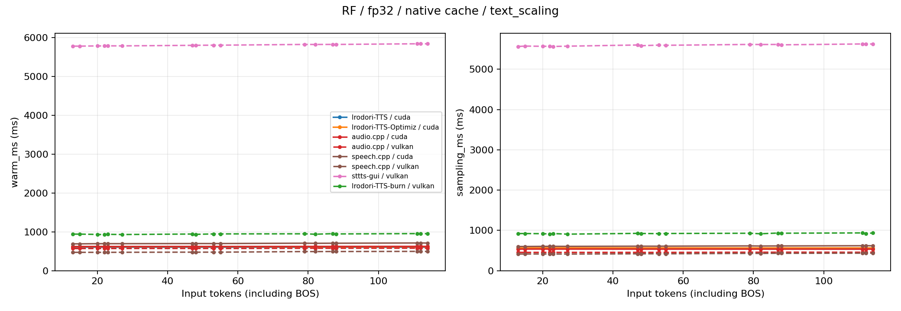

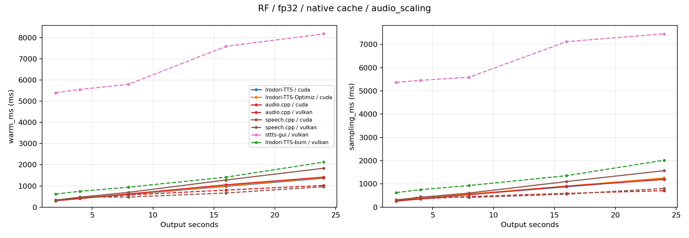

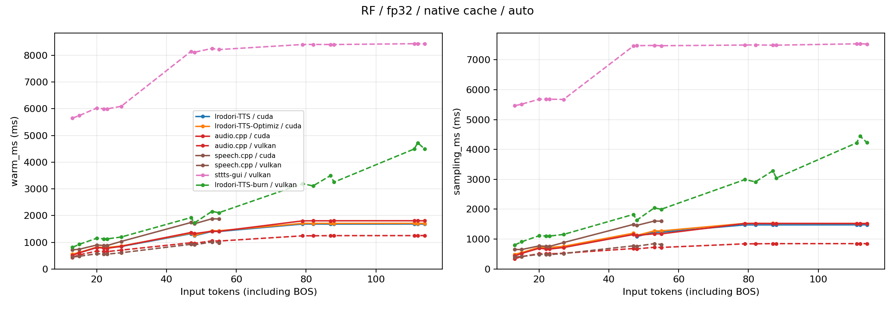

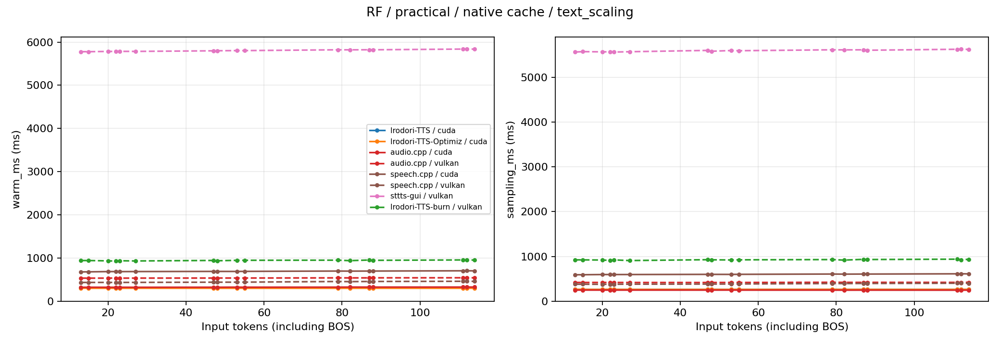

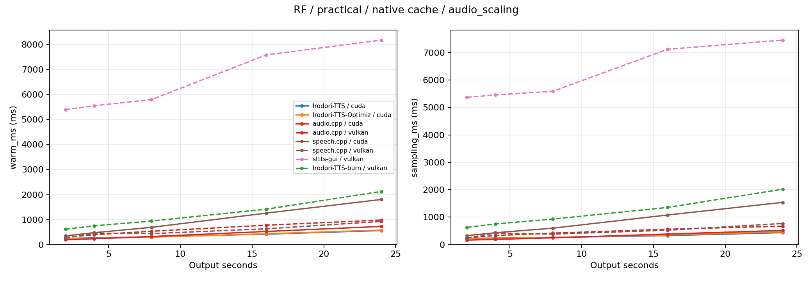

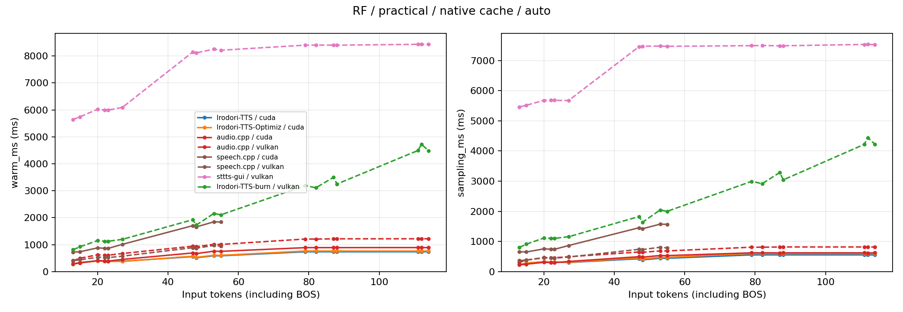

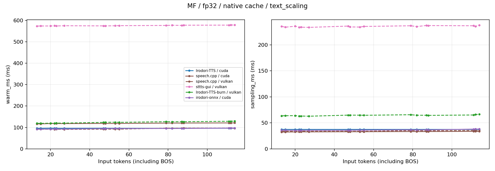

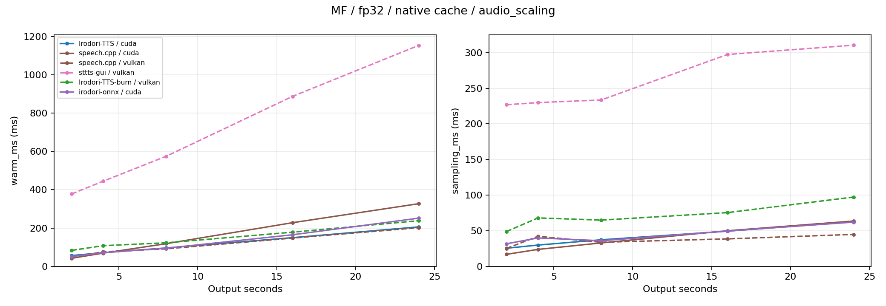

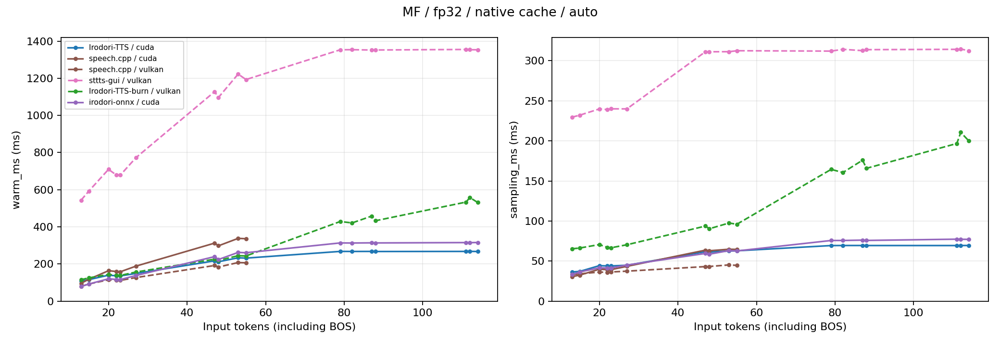

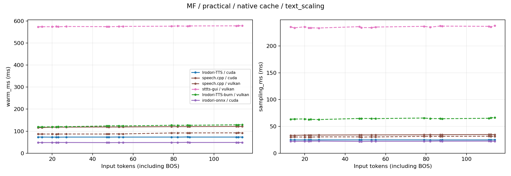

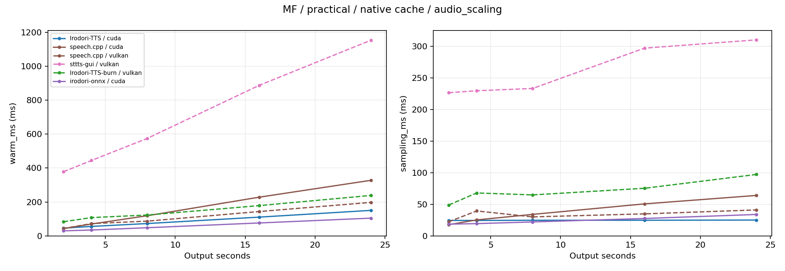

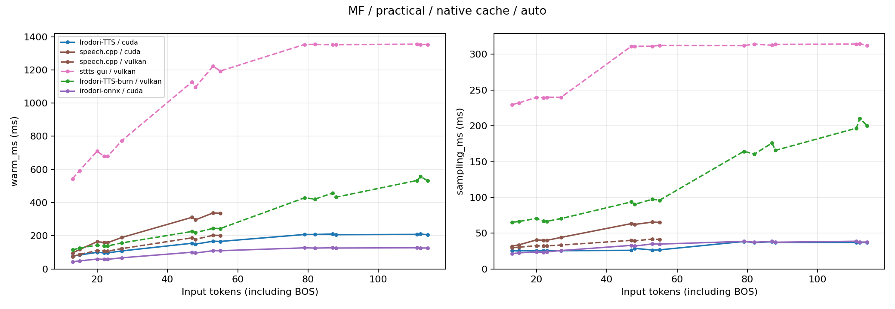

## 自動長予測（native cache）

| 実装 / model / backend / 精度 | 完了入力 | warm ms | 音声秒数 | RTF | 生成segment数 | 30秒以上の入力数 |
|---|---:|---:|---:|---:|---:|---:|
| Irodori-TTS-Optimiz / rf / cuda / fp32 | 20/20 | 1386.3 | 23.8 | 0.058 | 1 | 8 |
| Irodori-TTS-Optimiz / rf / cuda / bf16 | 20/20 | 587.2 | 23.8 | 0.025 | 1 | 8 |
| Irodori-TTS-burn / mf / vulkan / fp32 | 20/20 | 234.8 | 23.8 | 0.011 | 1 | 8 |
| Irodori-TTS-burn / rf / vulkan / fp32 | 20/20 | 2016.4 | 23.8 | 0.086 | 1 | 8 |
| Irodori-TTS / mf / cuda / fp32 | 20/20 | 224.5 | 23.8 | 0.009 | 1 | 8 |
| Irodori-TTS / mf / cuda / bf16 | 20/20 | 160.6 | 23.8 | 0.007 | 1 | 8 |
| Irodori-TTS / rf / cuda / fp32 | 20/20 | 1362.9 | 23.8 | 0.057 | 1 | 8 |
| Irodori-TTS / rf / cuda / bf16 | 20/20 | 571.0 | 23.8 | 0.025 | 1 | 8 |
| audio.cpp / rf / cuda / fp32 | 20/20 | 1388.2 | 23.8 | 0.060 | 1 | 8 |
| audio.cpp / rf / cuda / f16 | 20/20 | 721.5 | 23.8 | 0.030 | 1 | 8 |
| audio.cpp / rf / vulkan / fp32 | 20/20 | 1013.9 | 23.8 | 0.043 | 1 | 8 |
| audio.cpp / rf / vulkan / f16 | 20/20 | 975.7 | 23.7 | 0.041 | 1 | 8 |
| irodori-onnx / mf / cuda / fp32 | 20/20 | 250.3 | 23.8 | 0.011 | 1 | 8 |
| irodori-onnx / mf / cuda / fp16 | 20/20 | 105.5 | 23.8 | 0.004 | 1 | 8 |
| speech.cpp / mf / cuda / fp32 | 12/20 | 162.0 | 11.0 | 0.015 | 1 | 0 |
| speech.cpp / mf / cuda / f16 | 12/20 | 162.2 | 11.0 | 0.015 | 1 | 0 |
| speech.cpp / mf / vulkan / fp32 | 12/20 | 114.2 | 11.0 | 0.010 | 1 | 0 |
| speech.cpp / mf / vulkan / f16 | 12/20 | 109.4 | 11.0 | 0.010 | 1 | 0 |
| speech.cpp / rf / cuda / fp32 | 12/20 | 889.5 | 11.0 | 0.081 | 1 | 0 |
| speech.cpp / rf / cuda / f16 | 12/20 | 872.9 | 11.0 | 0.080 | 1 | 0 |
| speech.cpp / rf / vulkan / fp32 | 12/20 | 567.0 | 11.0 | 0.052 | 1 | 0 |
| speech.cpp / rf / vulkan / f16 | 12/20 | 532.0 | 11.0 | 0.048 | 1 | 0 |
| sttts-gui / mf / vulkan / fp32 | 20/20 | 1160.3 | 23.8 | 0.049 | 1 | 8 |
| sttts-gui / rf / vulkan / fp32 | 20/20 | 8181.2 | 23.8 | 0.344 | 1 | 8 |

## 制限・確認結果

audio.cppはMF、ONNXはRF、OptimizはMFに上流非対応。stttsとBurnはVulkanのみ。FP32共通基準は重みとcodecを揃えたもので、内部attention・積算の精度まで同一とは限らない。実用設定のONNX decoderはFP16、他のcodecはFP32。

speech.cppの自動長予測は30秒を超える要求を拒否する。該当入力は失敗一覧にstderrログとともに保存し、固定生成長の主比較とは区別する。

前処理はファイル読取り・正規化などのscopeを集計。codecの外側scopeに含まれる前処理は内側scopeの実測値を差し引き、重複計上しない。Burnはvoice登録のたびにcodec encoderを読み込むため、その時間をencoder load列で分離する。実際のpadding長・DiT形状・キャッシュhit率は入力別CSVに保存する。

NVMLピークは10ms間隔の観測値。allocatorのピークやGPU全体の値と同じ定義として扱わない。OS・ドライバのディスクキャッシュを維持し、GPUのクロック・電力制限は変更していない。

記録された失敗: 128件。[詳細](failures.json)。
