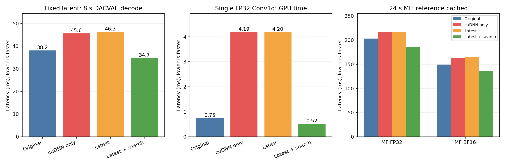

# 公式MF：最新版の速度低下の原因切り分け（2026-10-15）

**主因は、cuDNN 9.24のFP32 Conv1dにおける既定アルゴリズム選択。** PyTorch 2.10・CUDA 12.8を固定し、cuDNNだけを9.10.2→9.24.0に変更して速度低下を再現した。最大悪化層ではFFT＋GEMV経路を選択し、畳み込みの実測選択を有効にするとSGEMM系の経路で改善した。



## 比較環境

| 条件 | PyTorch | CUDAランタイム | cuDNN | benchmark |
|---|---|---|---|---|
| 旧環境 A | 2.10.0 | 12.8 | 9.10.2.21 | False |
| cuDNNのみ更新 B | 2.10.0 | 12.8 | 9.24.0.43 | False |
| 最新版 C | 2.14.1 | 13.0 | 9.24.0.43 | False |
| パッチ比較 P | 2.14.1 | 13.0 | 9.24.1.1 | False |
| 実測選択 C＋search | 2.14.1 | 13.0 | 9.24.0.43 | True |

RTX 5090、Python 3.10.20、CPUスレッド8。cuDNNはPyTorch最新版wheelの依存指定を基準とした。BはAからcuDNNのみ、PはCからcuDNNのみのパッケージ差であることをfreezeで確認した。B/Pは専用venvを作成し、診断目的の依存上書きとして`--no-deps`で構築した。実際にロードされたライブラリと実行時cuDNNバージョンも記録した。

## 1. 同一潜在入力でデコードを比較

旧環境の公式MF（p09、seed 42）で作った潜在入力を保存し、全環境で同じテンソルをデコード。A/B/Cは順序を反転する3ラウンド、各形状4回ウォームアップ後9回計測した。通常計測と演算・モジュールのプロファイルは分けている。以下は各ラウンド中央値の中央値（ms）。

| 条件 | 8秒音声 | 24秒音声 |
|---|---:|---:|
| 旧環境 | 38.15 | 120.91 |
| 旧環境＋cuDNNのみ更新 | 45.62 | 136.57 |
| 最新版 | 46.32 | 136.92 |
| 最新版＋実測選択 | 34.71 | 105.22 |

| 比較 | 8秒の差 | 24秒の差 | 24秒の95% CI |
|---|---:|---:|---|
| A→B：cuDNNのみ | +19.58% | +12.95% | [+12.63, +13.26]% |
| A→C：最新版全体 | +21.41% | +13.23% | [+12.79, +13.71]% |
| B→C：cuDNN版を揃えた残差 | +1.53% | +0.26% | [-0.23, +0.54]% |
| C→C＋search | -24.30% | -21.23% | [-22.01, -20.61]% |
| C→P：9.24.1パッチ | +0.66% | -0.03% | [-0.42, +0.36]% |
| C→cuDNN v7 API | -1.30% | +1.56% | [+0.67, +2.00]% |

実測選択の行は初期測定（3ラウンド×7回）を使用した。search/v7比較の初期C基準値は8秒45.85ms、24秒133.57ms。A/B/Cの追加確認とは測定時刻が異なる。

cuDNN単独更新と最新版全体で同程度の低下を再現した。9.24.1とv7 APIへの切り替えは回避にならなかった。NVIDIAは9.24.1で`cudnnBackendExecute`のCPU側オーバーヘッド修正を公表しているが、今回のGPU畳み込み経路の遅延はそのパッチでは解消しなかった。[NVIDIA公式リリースノート](https://docs.nvidia.com/deeplearning/cudnn/backend/latest/release-notes.html#cudnn-9-24-1)。

CIは3プロセスブロックとブロック内試行を階層bootstrap（5,000回、seed 42）した参考区間。A/B/Cおよびパッチ確認は時間対応のあるブロック、それ以外の別実験間比較は独立ブロックとして再標本化した。同一GPU・固定入力の小規模測定であり、母集団全体の性能保証ではない。

## 2. Conv1d単層まで縮小

最大悪化層は`decoder.model.1.block.4.block.1`。8秒音声で入力`[1,768,2400]`、重み`[768,768,7]`、stride=1、padding=3、dilation=1、FP32。この形状を固定乱数テンソルと`torch.nn.functional.conv1d`だけで再現した。MF、DACVAE、TorchAudio、TorchCodec、TorchAOを読み込まない独立プロセスで、3ラウンド×ウォームアップ6回＋通常20回。GPU eventで測り、演算プロファイルは別実行した。

| 条件 | GPU時間 ms | 1回のConvで起動されるカーネル |
|---|---:|---|
| 旧環境 | 0.747 | SGEMM系 1 |
| 旧環境＋cuDNNのみ更新 | 4.192 | FFT 21＋GEMV 10＝31 |
| 最新版 | 4.196 | FFT 21＋GEMV 10＝31 |
| 最新版＋実測選択 | 0.520 | SGEMM系 1 |

GPUトレースでは、旧版の`implicit_convolve_sgemm`から、9.24の`fft1d_r2c`／`fft1d_c2r`と`gemvx::kernel`へ変化した。実測選択で`implicit_convolve_sgemm`系に切り替わった。入力形状を揃えた単層でも再現するため、テキスト処理やMFのサンプリングを経由しない原因と確認できる。cuDNN内部のヒューリスティクスの判断理由や、最初に変化した中間バージョンの特定までは行っていない。

## 3. 公式MF全体で確認

p09、生成時間8/24秒、4ステップ、seed 42、モデル精度FP32/BF16、**codecは両方FP32**。参照再エンコード／参照潜在キャッシュの2条件で、3ラウンド×通常5回、別途段階プローブ3回を計測した。A/B/Cは順序を反転した同じ実験、C＋searchは別実験。以下は24秒音声の通常レイテンシ（ms）。

| モデル精度 | 参照条件 | 旧 A | cuDNNのみ B | 最新 C | C＋search |
|---|---|---:|---:|---:|---:|
| FP32 | reencode | 242.18 | 262.40 | 260.71 | 224.30 |
| FP32 | native_cache | 203.30 | 217.03 | 217.11 | 186.60 |
| BF16 | reencode | 193.72 | 216.04 | 215.39 | 181.35 |
| BF16 | native_cache | 149.44 | 163.86 | 164.65 | 135.95 |

参照キャッシュ有効・24秒の段階別計測（ms）：

| モデル精度 | 条件 | MF sampling | DACVAE decode | 参照準備＋speaker |
|---|---|---:|---:|---:|
| FP32 | 旧環境 | 62.30 | 117.82 | 2.50 |
| FP32 | 旧環境＋cuDNNのみ更新 | 62.28 | 135.18 | 2.50 |
| FP32 | 最新版 | 61.79 | 136.37 | 2.59 |
| FP32 | 最新版＋search | 61.95 | 103.89 | 2.59 |
| BF16 | 旧環境 | 24.50 | 113.81 | 2.79 |
| BF16 | 旧環境＋cuDNNのみ更新 | 25.60 | 126.36 | 2.84 |
| BF16 | 最新版 | 25.55 | 126.40 | 2.86 |
| BF16 | 最新版＋search | 25.17 | 98.04 | 2.84 |

MF samplingの差は小さく、デコードの増加が支配的。参照再エンコードでも、FP32条件の参照codecネットワークが24.62→29.25msへ増加する一方、音声読み込み・正規化は約20msのままだった。MFは4ステップで生成が短く、共通のFP32 codecの遅延が全体に占める割合が大きい。モデルをBF16にしてもcodecはFP32なので、同じデコードの遅延が残る。

段階プローブはGPU同期を挿入する補助計測であり、合計を通常レイテンシとはみなさない。モジュールGPU eventも実行を多少変えるため、原因の効果量には通常計測と単層再現を優先した。

## 回避設定の評価と範囲

`torch.backends.cudnn.benchmark = True`を専用ワーカー内だけで有効化すると、通常レイテンシはFP32/BF16とも旧環境以下になった。[PyTorch公式仕様](https://docs.pytorch.org/docs/2.14/backends.html#torch.backends.cudnn.benchmark)では、複数の畳み込みアルゴリズムを実測して最速を選ぶ設定。形状初回の探索コストがあり、単層の初回呼び出しは最新版既定の約51msに対し実測選択で約112msだった。MF全体でのコールド時間や多様な動的形状への総合適用性は今回の判定対象に含めない。元環境の設定・エンジン実装には適用していない。

固定潜在入力のcodec出力の相対L2最大値は1.27e-06、MF全体のFP32は7.72e-06。BF16は最大0.493で波形の同一性は確認できていない。波形差は位相差にも影響されるため、音質劣化の判定には使っていない。聴感/MOSは未評価。原因の判定は、同一潜在入力・FP32の比較と単層再現を主な証拠としている。

## 検証・保存

- 通常1296件、段階／モジュール／演算プローブ720件。別途、Conv単層18プロセス×20回。
- 全出力で48kHz、指定サンプル長、有限・非無音を確認。公式MFの段階プローブは全て4 forward。
- 元の3環境、前回の最新版3環境、制御用環境のmetadataと前回結果など計1164ファイルのSHA-256が前後一致。
- MFモデル、codec重み、参照音声のSHA-256も前回の記録と一致。
- GPU監視880サンプルでcomputeプロセスの重複0、温度48–70℃。監視は初期codec試験の後半から開始。初期試験も共通GPUロックで直列実行。
- 生データ・固定潜在入力・GPUトレース・freeze・監視ログは`artifacts/mf-runtime-cause-20261015/`。追加環境は`.venvs/mf-runtime-cause-20261015/`。
- 大きい演算別プロファイル`operators.csv`と重複集計`summary.json`は`artifacts/mf-runtime-cause-20261015/report/`に保存し、Git管理の対象外とする。
- 集計は[measurements.csv](measurements.csv)、差とCIは[comparisons.csv](comparisons.csv)、層別は[modules.csv](modules.csv)、単層は[conv-probe.csv](conv-probe.csv)、検証は[validation.json](validation.json)。

## 再現手順

このワークスペースの元環境・モデルと、前回のruntime-ab環境を利用する。元環境へのinstall/syncは行わない。同じタグの完了済みラウンドは再利用するため、再測定時は別の`--tag`か専用の結果保存先を使う。

```bash
PYTHONDONTWRITEBYTECODE=1 benchmark/.venv/bin/python benchmark/mf_cause_setup.py
PYTHONDONTWRITEBYTECODE=1 benchmark/.venv/bin/python benchmark/mf_cause.py capture --stacks old --seconds 2 8 24
PYTHONDONTWRITEBYTECODE=1 benchmark/.venv/bin/python benchmark/mf_cause.py codec --stacks old new --modes default
PYTHONDONTWRITEBYTECODE=1 benchmark/.venv/bin/python benchmark/mf_cause.py codec --stacks old new --modes benchmark v7 --seconds 8 24
PYTHONDONTWRITEBYTECODE=1 benchmark/.venv/bin/python benchmark/mf_cause.py codec --stacks old924 cudnn9241 --modes default benchmark
PYTHONDONTWRITEBYTECODE=1 benchmark/.venv/bin/python benchmark/mf_cause.py codec --stacks old old924 new --seconds 8 24 --repeats 9 --tag confirmation
PYTHONDONTWRITEBYTECODE=1 benchmark/.venv/bin/python benchmark/mf_cause.py codec --stacks new cudnn9241 --seconds 8 24 --repeats 9 --tag patch-confirmation
PYTHONDONTWRITEBYTECODE=1 benchmark/.venv/bin/python benchmark/mf_cause.py e2e --stacks old new old924 --seconds 8 24 --repeats 5
PYTHONDONTWRITEBYTECODE=1 benchmark/.venv/bin/python benchmark/mf_cause.py e2e --stacks new --modes benchmark --seconds 8 24 --repeats 5
PYTHONDONTWRITEBYTECODE=1 benchmark/.venv/bin/python benchmark/mf_conv_probe.py
PYTHONDONTWRITEBYTECODE=1 benchmark/.venv/bin/python benchmark/mf_cause_report.py
```
